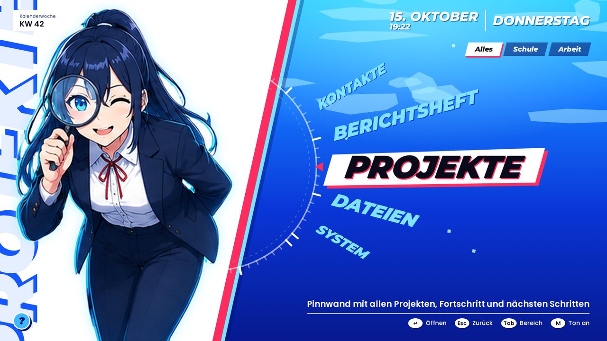
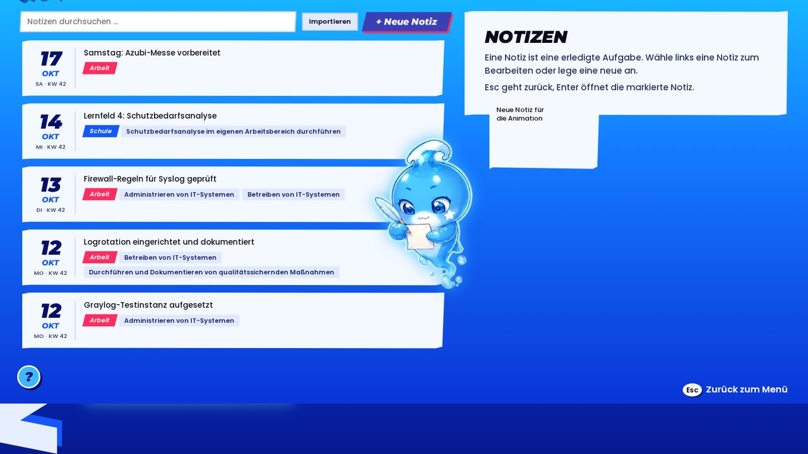
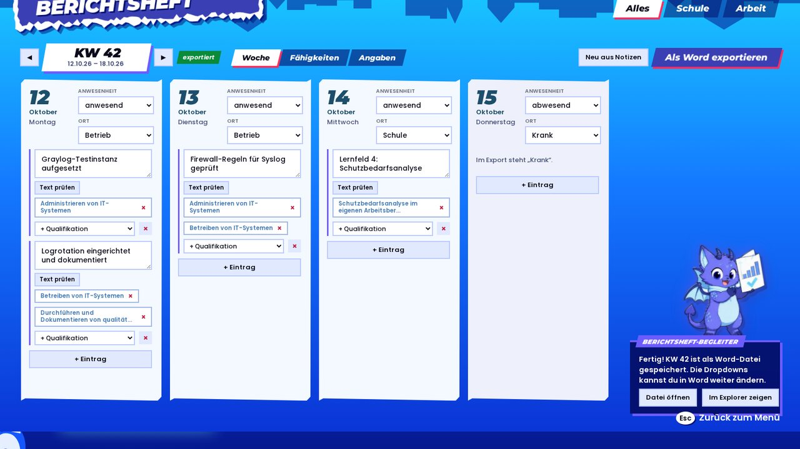
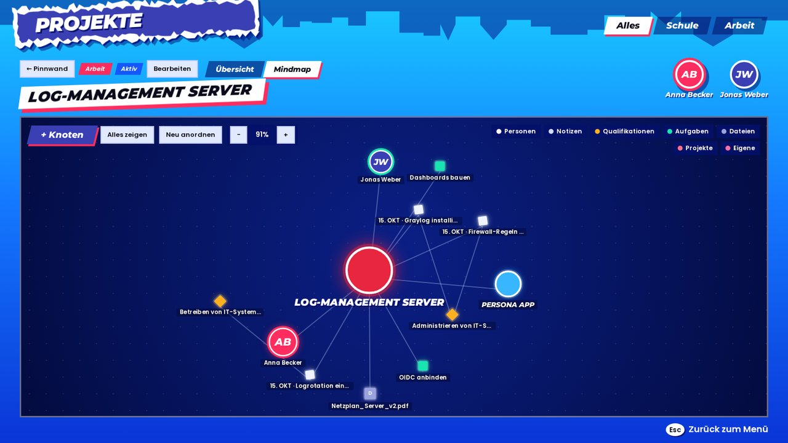
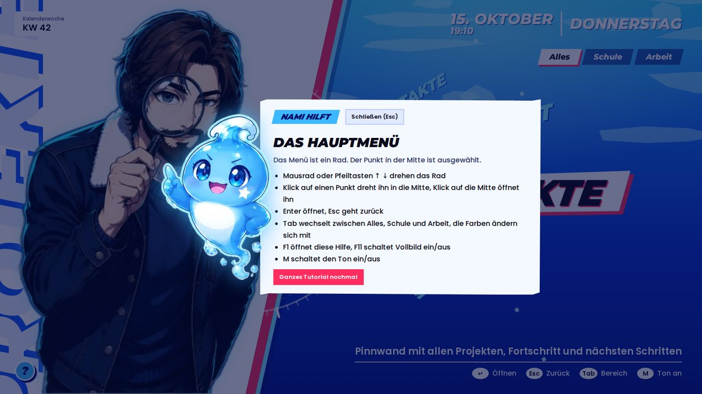

<p align="center">
  
</p>

<h1 align="center">AzuNavi</h1>

<p align="center">
  <b>Dein Navigator durch die Ausbildung</b><br>
  Notizen, Kontakte, Projekte, Dateien und Berichtsheft – in einer App, im Stil eines japanischen Rollenspiels.<br>
  Läuft komplett lokal auf deinem Rechner. Keine Cloud, kein Konto.
</p>

<p align="center">
  
</p>

---

## Download

👉 **[Neueste Version herunterladen](../../releases/latest)** (Seite „Releases“, unten bei „Assets“)

Es gibt zwei Varianten – du entscheidest:

| Datei | Was ist das? | Für wen? |
|---|---|---|
| **`AzuNavi_1.9.0-setup.exe`** | **Installer** | Für die meisten die beste Wahl. Installiert AzuNavi nur für dich (keine Adminrechte nötig), legt Startmenü- und Desktop-Verknüpfung an, lässt sich normal deinstallieren. |
| **`AzuNavi_1.9.0.exe`** | **Portable** (ohne „setup“) | Keine Installation. Einfach starten – auch vom USB-Stick. Legt beim ersten Start selbst eine Desktop-Verknüpfung an. |

**Voraussetzung:** Windows 10 oder 11 (64 Bit). Mehr brauchst du nicht.

---

## Installation in 3 Schritten

### 1. Datei herunterladen
Auf der [Release-Seite](../../releases/latest) unter **Assets** auf die gewünschte Datei klicken.

### 2. Windows-Warnung bestätigen
Beim ersten Start zeigt Windows wahrscheinlich:

> **Der Computer wurde durch Windows geschützt**

Das ist normal: AzuNavi ist ein kostenloses Hobby-Projekt und nicht mit einem kostenpflichtigen Zertifikat signiert. So geht's weiter:

1. Auf **„Weitere Informationen“** klicken
2. Auf **„Trotzdem ausführen“** klicken

### 3. Loslegen
- **Installer:** Installation durchklicken (dauert wenige Sekunden), AzuNavi startet danach aus dem Startmenü oder vom Desktop.
- **Portable:** Die `.exe` an einen Ort deiner Wahl legen (z. B. `Dokumente\AzuNavi`) und doppelklicken.

> 💡 Auf einem **Firmen- oder Schulrechner** bitte vorher die IT fragen, ob du eigene Programme starten darfst.

---

## Erster Start: das Tutorial

Beim ersten Start begrüßt dich **Nami**, ein kleiner Wassergeist, und führt dich durch die Einrichtung:

<p align="center">
  
</p>

1. **Wer bist du?** – Name, Ausbildungsberuf, Fachrichtung, zuständige Kammer (IHK, HWK …), Betrieb, Ausbilder/in
2. **Wähle deine Figur** – sechs Anime-Figuren stehen zur Auswahl
3. **Dein Berichtsheft** – lade eine Kopie deines Berichtshefts als Word-Datei hoch, dann erzeugt AzuNavi deine Wochenberichte im selben Format (oder nutze das eingebaute IHK-Layout)
4. **Deine Qualifikationen** – für Fachinformatiker/innen ist die IHK-Liste schon drin, für andere Berufe kannst du deine eigene Liste einfügen
5. **Alte Berichtshefte mitnehmen** – bisherige Berichtshefte (Word oder PDF) werden zu Notizen
6. **Rundgang** durch alle Bereiche – die App zeigt dir, wo was liegt, und du probierst es gleich selbst aus: Sobald du die kleine Aufgabe erledigt hast, geht es von selbst weiter. Nami führt durch die App, Eda erklärt die Dateien und Caramella das Berichtsheft.

Alles lässt sich überspringen und später unter **System → Tutorial wiederholen** nachholen.

---

## Was kann AzuNavi?

| Bereich | Was du dort machst |
|---|---|
| **Notizen** | Festhalten, was du erledigt hast – mit Datum, Bereich (Schule/Arbeit), IHK-Qualifikation, Projekt, Personen und Bildern. Mit Rechtschreib- und Grammatikprüfung. |
| **Kontakte** | Dein Personen-Netzplan: Ausbilder, Kolleginnen, Lehrkräfte – mit eigenen Zonen für Schule und Arbeit, mehreren Vor- und Untergeordneten je Person. |
| **Berichtsheft** | Der Wochenbericht entsteht automatisch aus deinen Notizen. Anpassen und als **Word-Datei** exportieren. Dazu eine **Fähigkeiten-Übersicht** für deinen Ausbilder. |
| **Projekte** | Große Netzplan-Übersicht aller Projekte (Doppelklick zoomt hinein) oder Detektiv-Pinnwand mit Fäden, dazu Fortschritt, „Was als Nächstes“ und eine **Mindmap** pro Projekt. |
| **Dateien** | Deine echten Ordner für Arbeit und Schule. Eine Assistentin hilft beim Einsortieren – nichts wird gelöscht oder überschrieben. |
| **System** | Schriftgröße, Animationen, Maskottchen, Anzeige (Fenster/randlos/Vollbild), Sicherung, Import. |

<p align="center">
  
  
  
  
</p>

---

## Bedienung

| Taste | Funktion |
|---|---|
| **Mausrad / ↑ ↓** | Menü-Rad drehen |
| **Enter** | Öffnen |
| **Esc** | Zurück |
| **Tab** | Bereich wechseln: Alles / Schule / Arbeit |
| **F1** oder **?**-Knopf | Hilfe zur aktuellen Seite |
| **F11** | Vollbild ein/aus (AzuNavi startet im Vollbild) |
| **M** | Ton ein/aus |

---

## Häufige Fragen

<details>
<summary><b>Wo liegen meine Daten?</b></summary>

Alles bleibt auf deinem Rechner, in `%APPDATA%\com.local.personaapp`. Es wird nichts ins Internet geschickt. Installer und portable Version nutzen denselben Datenordner – nimm am besten nur eine Variante pro Rechner.
</details>

<details>
<summary><b>Wie nehme ich meine Daten auf einen anderen Laptop mit?</b></summary>

1. Alter Laptop: **System → Sicherung erstellen** (eine `.zip`-Datei)
2. Sicherung auf den neuen Laptop kopieren, AzuNavi dort installieren oder starten
3. Tutorial überspringen, **System → Sicherung einspielen**
4. Unter **Dateien** die Ordner Arbeit/Schule neu wählen (die echten Ordner kopierst du selbst)
</details>

<details>
<summary><b>Wie mache ich ein Update?</b></summary>

- **Installer:** neue `-setup.exe` herunterladen und einfach drüber installieren.
- **Portable:** alte `.exe` durch die neue ersetzen.

Deine Daten bleiben in beiden Fällen erhalten. Zur Sicherheit vorher eine Sicherung erstellen.
</details>

<details>
<summary><b>Wie deinstalliere ich AzuNavi?</b></summary>

- **Installer:** Windows-Einstellungen → Apps → AzuNavi → Deinstallieren.
- **Portable:** die `.exe` und die Desktop-Verknüpfung löschen.

Wenn du auch alle Daten entfernen willst: vorher in AzuNavi **System → App zurücksetzen**, oder den Ordner `%APPDATA%\com.local.personaapp` löschen.
</details>

<details>
<summary><b>Bessere Grammatikprüfung mit LanguageTool (optional)</b></summary>

AzuNavi prüft Rechtschreibung von Haus aus (offline, mit Hunspell). Für eine richtige **Grammatikprüfung** kannst du LanguageTool einbinden – ebenfalls komplett offline:

1. Java 17 oder neuer installieren, z. B. mit `winget install EclipseAdoptium.Temurin.21.JRE`
2. Auf [languagetool.org](https://languagetool.org) die Offline-Version **„LanguageTool Desktop“** herunterladen und entpacken
3. In AzuNavi: **System → Grammatik → Ordner wählen** und den entpackten Ordner auswählen

Der erste Start dauert bis zu 30 Sekunden, danach steht dort „läuft ✓“.
</details>

<details>
<summary><b>Meine Berichtsheft-Vorlage wird nicht erkannt</b></summary>

AzuNavi erkennt Vorlagen mit Tageskarten und Dropdowns automatisch. Für andere Word-Vorlagen schreibst du Platzhalter an die passenden Stellen und lädst sie erneut hoch, z. B.:

`{{NAME}}` `{{BERUF}}` `{{BETRIEB}}` `{{AUSBILDER}}` `{{KAMMER}}` `{{KW}}` `{{JAHR}}` `{{ZEITRAUM}}` `{{WOCHE}}` `{{MONTAG}}` … `{{SONNTAG}}` `{{MONTAG_DATUM}}` `{{MONTAG_ORT}}`

PDF-Vorlagen können nicht befüllt werden – aus PDFs werden aber die Einträge importiert.
</details>

<details>
<summary><b>Windows-Warnung bei jedem Download?</b></summary>

Ja, solange die App nicht kostenpflichtig signiert ist, warnt Windows (SmartScreen) bei neuen Versionen. Das ist bei vielen kostenlosen Projekten so. Der Quellcode liegt offen in diesem Repository – du kannst also nachsehen, was die App macht, oder sie selbst bauen.
</details>

---

## Selbst bauen (für Entwickler)

<details>
<summary>Anleitung anzeigen</summary>

**Voraussetzungen:** [Node.js](https://nodejs.org) 20+, [Rust](https://rustup.rs) und die [Tauri-Voraussetzungen für Windows](https://tauri.app/start/prerequisites/) (Visual Studio Build Tools mit „Desktopentwicklung mit C++“, WebView2).

```powershell
git clone https://github.com/DEIN-NAME/azunavi.git
cd azunavi
npm install
npm run tauri dev                     # Entwicklungsmodus
powershell -ExecutionPolicy Bypass -File .\build-release.ps1   # Installer + portable .exe
```

**Technik:** Tauri 2 · React 18 · TypeScript · Vite · SQLite · Hunspell (WebAssembly) · pdf.js

**Neue Version veröffentlichen:** Version in `package.json`, `src-tauri/tauri.conf.json` und `src-tauri/Cargo.toml` erhöhen, dann

```powershell
git tag v1.0.1
git push --tags
```

GitHub baut daraufhin automatisch Installer und portable `.exe` und hängt beide an das Release (siehe `.github/workflows/release.yml`).
</details>

---

## Lizenz

Der Quellcode steht unter der [MIT-Lizenz](LICENSE).
Die Figuren, das Maskottchen und das Icon sind für die Nutzung mit AzuNavi gedacht.
Das deutsche Wörterbuch stammt aus [dictionary-de](https://github.com/wooorm/dictionaries) – Lizenz siehe `src/assets/dict/LICENSE-dictionary-de.txt`.

AzuNavi ist ein privates Fan-Projekt, inspiriert von japanischen Rollenspielen. Es steht in keiner Verbindung zu Atlus oder SEGA.

## Linux

AzuNavi gibt es auch für Linux (Debian, Ubuntu, Mint u. a.). Auf der Release-Seite:

- **`.deb`**: `sudo apt install ./AzuNavi_<version>_amd64.deb`, danach im Menü starten.
- **`.AppImage`**: `chmod +x AzuNavi_<version>_amd64.AppImage` und starten. Braucht `libfuse2` (`sudo apt install libfuse2`).
- Selbst bauen: `./build-linux.sh` (installiert die nötigen Pakete und baut beide Formate).
- Die optionale Grammatikprüfung (LanguageTool) braucht Java: `sudo apt install openjdk-21-jre`.
- Deine Datenbank liegt unter `~/.config/com.local.personaapp/`, Anhänge und Porträts unter `~/.local/share/com.local.personaapp/`. Sicherungen (System → Daten mitnehmen) laufen wie unter Windows und lassen sich zwischen Windows und Linux austauschen.

## Android (Test)

AzuNavi läuft als Test auch auf Android-Handys (arm64, Querformat). Gebaut wird auf GitHub: **Actions → „Android bauen“ → „Run workflow“**. Die APK hängt danach an einem Vorab-Release „android-test-…“.

- Installation: APK aufs Handy laden, „Installation aus dieser Quelle erlauben“, öffnen.
- Die Android-Zurück-Geste wirkt wie Esc. Über das Menü-Rad wischen dreht es.
- Nur am PC: Dateien (echte Ordner), LanguageTool (Java), Anzeige-/Fenstereinstellungen, Desktop-Verknüpfung.
- Für Updates ohne Datenverlust einen eigenen Signaturschlüssel als GitHub-Secret hinterlegen (siehe `.github/workflows/android.yml`).

## Sicherung in deiner Cloud (OneDrive & Co.)

AzuNavi läuft komplett lokal. Wer PC und Handy nutzen will, sichert in den **eigenen** Cloud-Speicher: unter System (PC) bzw. Mehr (Handy) → „Sicherung in deiner Cloud“.
- **PC:** einmal den Cloud-Ordner wählen (z. B. `C:\Users\NAME\OneDrive\AzuNavi`), danach sichert ein Klick dorthin. OneDrive lädt die Datei selbst hoch.
- **Handy:** beim Sichern im Android-Speicherdialog **OneDrive** wählen. Zum Holen die Datei dort auswählen.
- Die Sicherung wird mit deinem Passwort verschlüsselt (AES-256-GCM). Ohne Passwort kann sie niemand öffnen, auch der Cloud-Anbieter nicht.
- Es wird immer die ganze Sicherung übertragen: vor dem Gerätewechsel sichern, auf dem anderen Gerät holen.
